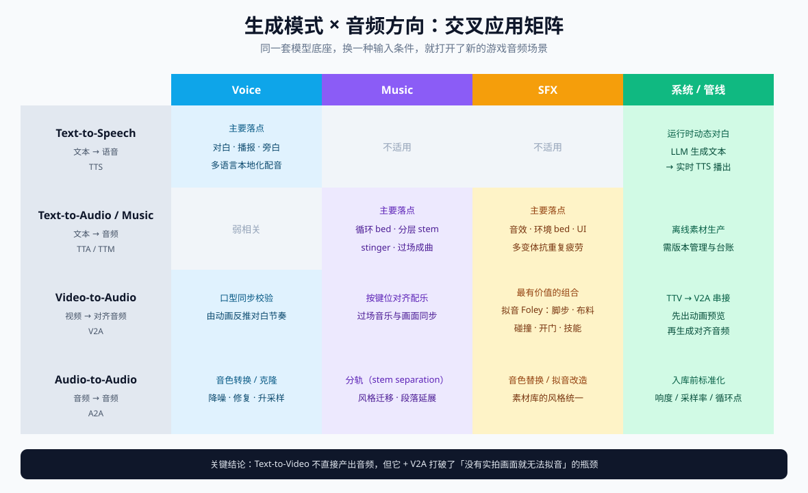
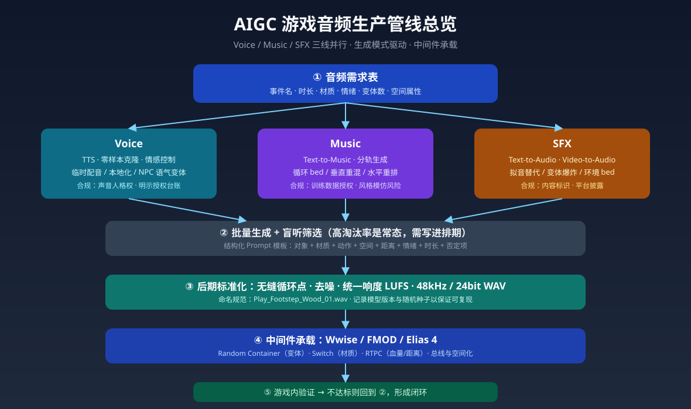
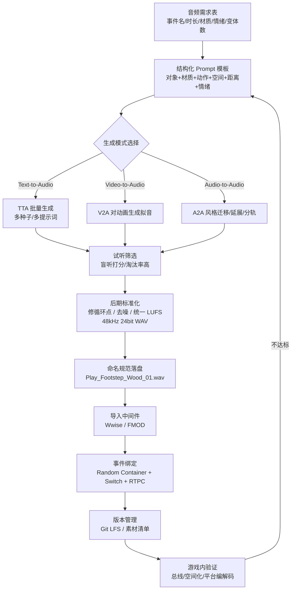

# 当下 AIGC 在游戏音频设计中的应用

> **课程**：SHU261 基础实践
> **学号**：24122099
> **姓名**：唐清文
> **文档类型**：调研报告
> **主题**：当下 AIGC（AI Generated Content）在游戏音频设计中的应用

---

## 摘要

游戏音频设计长期由三条并行的生产线构成：**Voice（对白与人声）**、**Music（音乐）** 与 **SFX（音效与拟音）**，三者最终都要汇入 Wwise / FMOD / Elias 之类的音频中间件，才能与游戏状态实时交互。过去十年，这三条线的成本结构高度依赖"人 + 录音棚 + 素材库"。

2023 年以来，以**神经音频编解码器（Neural Audio Codec）+ 生成模型**为共同底座的 AIGC 技术，开始同时渗透进这三条线：

- **Voice**：零样本语音克隆（zero-shot voice cloning）与情感可控 TTS，让"临时配音（scratch VO）→ 多语言本地化 → NPC 语气变体"的成本下降了一个数量级；
- **Music**：文本/旋律条件音乐生成 + 分轨（stem）输出，使"分层自适应配乐"从昂贵的定制作曲变成可批量试错的生产流程；
- **SFX**：文本生音频（Text-to-Audio）与视频生音频（Video-to-Audio）让拟音（Foley）和变体（variant）生产从"录音棚 + 道具"转向"提示词 + 批量筛选"。

本报告从 **Voice / Music / SFX 三个方向** 与 **Text-to-Audio、Video-to-Audio 等生成模式** 两条线索交叉展开，梳理技术底座、代表性模型与产品、可落地的工作流（Prompt → 标准化 → 中间件事件）、工程规范（采样率、循环点、响度、命名），并重点讨论**版权、声音人格权、内容标识合规与从业者权益**四类风险。

**说明（调研方法）**：本报告基于官方文档、模型论文与开源仓库、行业报道及现行法规整理，**属于文献与资料调研**，未包含主观听感盲测实验；文中对音质的主观描述均标注为"资料/厂商口径"，实际项目选型建议以本地 A/B 盲听为准。

---

## 1. 调研背景与范围

### 1.1 为什么是游戏音频

游戏音频与影视音频最大的差别在于**非线性和交互性**：

| 维度 | 影视音频 | 游戏音频 |
| --- | --- | --- |
| 时间轴 | 线性、固定 | 非线性、由玩家状态驱动 |
| 素材复用 | 一次使用 | 反复触发，需大量变体抗"重复疲劳" |
| 结构 | 完整成品 | 可拼接的片段 / 分层 stem |
| 混音 | 一次性终混 | 实时混音（总线、RTPC、Snapshot） |
| 交付 | 母版文件 | 中间件工程 + SoundBank |

这意味着游戏音频对**"数量"和"可控性"**的需求远高于影视：一个角色可能有 3000 条对白，一个脚步事件可能需要 24 个变体 × 6 种材质。AIGC 的价值恰好落在"批量生成 + 参数化控制"这两点上，而非单纯"替代作曲"。

### 1.2 本次调研的边界

- **在范围内**：语音合成与克隆、音乐生成与自适应音乐、音效/拟音生成、生成模式分类、中间件集成、合规与伦理。
- **不在范围内**：语音识别（ASR）、对话式 AI NPC 的 NLP 部分（仅在与会话式语音管线耦合时提及）、通用音频降噪修复（仅在后期环节顺带提及）。

---

## 2. 技术底座：AIGC 音频模型全景

### 2.1 共同架构：神经编解码器 + 生成器

绝大多数当下的音频生成模型可以抽象为同一套三段式结构：

```
离散/连续的音频潜表征              条件信号
        ▲                            │
        │                            ▼
[ 神经音频编解码器 ] ←────── [ 条件生成器（AR / Diffusion / Flow） ]
  EnCodec / DAC /           Text / Melody / Video / Reference Audio
  SoundStream / WavTokenizer
        │
        ▼
   重建为波形（HiFi-GAN / Vocos / 扩散声码器）
```

- **编解码器**把 48 kHz 波形压成低帧率 token 或连续隐变量，是"音频能否像文本一样被建模"的关键；
- **生成器**分两大流派：
  - **自回归 token 模型**（MusicGen、AudioGen）：把音频当"语言"逐 token 生成，长时序连贯性好，但生成慢、易漂移；
  - **潜空间扩散 / 流匹配**（AudioLDM 2、Stable Audio、AudioX）：并行去噪、条件控制灵活（inpainting、超分、时长控制），但对齐精度依赖条件编码器。

### 2.2 按生成模式分类

这是本次调研的**第二条主线**：不看"生成什么"，而看"用什么输入生成"。

| 生成模式 | 输入 → 输出 | 游戏音频中的典型用途 | 可控性 | 主要痛点 |
| --- | --- | --- | --- | --- |
| **TTS** Text-to-Speech | 文本 → 语音 | 对白、播报、旁白、本地化配音 | 高（音色/语速/情绪） | 长句韵律、专有名词读法、情感跨度 |
| **TTA** Text-to-Audio | 文本 → 通用音频 | 音效、环境音、拟音、UI 音 | 中高 | 精确时长、瞬态质感、物理合理性 |
| **TTM** Text-to-Music | 文本（+旋律）→ 音乐 | 配乐、循环 bed、stinger | 中 | 无缝循环、调性/BPM 一致性、结构可控 |
| **V2A** Video-to-Audio | 视频 → 与画面同步的音频 | 过场动画拟音、角色动作音、预告片 | 高（时间对齐） | 需先有画面；对白/音乐需分离处理 |
| **A2A** Audio-to-Audio | 音频 → 音频 | 风格迁移、音色转换、补全/延展、分轨/去混、升采样 | 高 | 伪影累积、相位问题 |
| **TTV** Text-to-Video | 文本 → 视频 | **不直接产出音频**，但可作为前置：生成分镜/动画参考 → 再喂给 V2A | 低 | 无同步音轨，需串接 V2A |

> **关键判断**：`Text-to-Video` 本身不生成音频，但它把"没有实拍素材就没法做拟音"这个瓶颈打破了——先用 TTV 生成动画预览，再用 V2A 生成与之时间对齐的音效，这条 **TTV → V2A → 人工精修** 的链路，是 2025 年游戏过场动画音频的新工作流。



*图 1：生成模式 × 音频方向交叉应用矩阵（点击图片可放大查看）*

### 2.3 代表性模型与产品（截至调研时点的公开资料）

> 下表为**资料整理**，版本迭代极快，具体能力请以官方页面为准。

**语音（Voice）**

| 名称 | 类型 | 说明 |
| --- | --- | --- |
| VALL-E / Voicebox | 研究 | 零样本 TTS 的开创性工作，奠定"3 秒参考音克隆"范式 |
| ElevenLabs | 商业 | 语音合成/克隆/多语言配音，游戏与独立开发者用得多 |
| GPT-4o mini TTS / OpenAI 语音 API | 商业 | 与 LLM 管线整合，适合动态生成对白 |
| CosyVoice 2、F5-TTS、GPT-SoVITS、IndexTTS | 开源 | 中文社区活跃，可控性强，适合本地化与私有部署 |
| Seed-TTS（字节）、MegaTTS | 研究/闭源 | 高自然度中文语音的代表 |

**音乐（Music）**

| 名称 | 类型 | 说明 |
| --- | --- | --- |
| MusicGen / AudioCraft | 开源（Meta） | 文本+旋律条件，可控性强，常被用作研究基线 |
| Stable Audio Open | 开源（Stability AI） | 训练数据以 CC 授权音库为主，**商用合规性相对清晰**，适合作为落地首选 |
| ACE-Step、YuE、Riffusion | 开源 | 2025 年前后出现的开源音乐生成方案 |
| Suno、Udio | 商业 | 整首歌级生成，质量高，但训练数据版权处于诉讼争议中 |
| Mureka、Seed-Music、Lyria | 商业 | 分别来自昆仑万维、字节、Google |

**音效（SFX）**

| 名称 | 类型 | 说明 |
| --- | --- | --- |
| AudioGen / AudioLDM 2 | 开源 | 经典 Text-to-Audio 基线 |
| ElevenLabs Sound Effects | 商业 | 文本提示生成短音效，API 友好，便于批量管线化 |
| **HunyuanVideo-Foley** | 开源（腾讯） | Video-to-Audio 拟音，可直接对角色动画批量生成物理音效 |
| MMAudio、AudioX | 开源 | 视频生音频的轻量/通用方案 |
| FoleyDirector | 研究（CVPR 2026） | 用结构化脚本做细粒度时间对齐的 V2A |
| DeepMind V2A | 研究 | 视频生音频的代表性研究，尚未产品化 |

---

## 3. Voice 方向：从"配音"到"声音资产工业化"

### 3.1 三类落点

1. **原型期临时配音（Scratch VO）**
   开发早期剧本频繁改动，正式配音（往往按字数/小时计费）极不经济。用 TTS 生成"能听懂的临时音轨"，让策划在开发期就能评估节奏、时长与口型，等文本冻结后再请真人配音。**这是当前争议最小、ROI 最高的用法。**

2. **多语言本地化（Localization）**
   一部 3A 作品可能要做 10+ 语种配音。AIGC 有两种打法：
   - **AI 直接配音**：成本极低，但情感与语言地道度受限；
   - **AI 辅助 + 真人校订**：AI 出首版，配音导演只做调整，效率与质量折中——这是目前商业项目更常见的形态。

3. **NPC 语气变体（Barks / Variants）**
   同一句台词需要"平静 / 受伤 / 愤怒 / 远距离喊话"多个版本，真人录制成本随变体数线性增长，而 TTS 只要改参数。配合中间件 Switch/RTPC，可按血量、距离、情绪实时切换。

### 3.2 "声音身份"必须被当作资产来管理

语音克隆让"某演员的声音"变成一份可复用的**模型资产**。工程上需要建立：

- **授权台账**：谁的声音、授权范围（哪些项目/期限/是否可再训练）、是否允许二次衍生；
- **版本化**：voice model 本身要进版本管理（权重、参考音频、训练配置、生成参数）；
- **水印与追溯**：生成音频应可回溯到"哪个模型 + 哪次授权"，这也是法规标识要求的落地手段（见 §9）。

### 3.3 行业事件：Fortnite 的 AI 达斯·维达

2024–2025 年间，Epic 在《Fortnite》中使用 AI 生成达斯·维达语音，引发美国演员工会（SAG-AFTRA）的公开反对，最终成为 2025 年**互动媒体协议（Interactive Media Agreement）**中就 AI 声音条款博弈的标志性案例之一。该协议的核心诉求正是：**AI 使用须经演员明示同意 + 合理补偿 + 披露**。

**对课程实践的启示**：即便是学生项目，也应养成"AI 语音素材标注来源与授权状态"的习惯——这不是形式主义，而是行业标准做法提前落地。

---

## 4. Music 方向：从"作曲"到"自适应配乐系统"

### 4.1 三种生成层级

| 层级 | 说明 | AIGC 参与度 |
| --- | --- | --- |
| **静态成曲** | 主题曲、片尾曲、过场铺底 | 可整曲生成，人工混音 |
| **可循环 bed** | 探索、战斗、潜行等状态循环 | 生成 stem 后人工修循环点 |
| **自适应结构** | 随游戏状态动态变化 | 生成素材 + 中间件规则驱动 |

### 4.2 自适应音乐的两条经典技术路线

- **垂直重混（Vertical Remixing）**：同一段音乐拆成多层（节奏层/和声层/旋律层），按战斗强度实时增减层数。
- **水平重排（Horizontal Re-sequencing）**：把音乐切成段落，按状态在段落间跳转，用过渡段（transition segment）或点缀音（stinger）衔接。

Wwise 的 Interactive Music 体系与 FMOD 的过渡时间轴都原生支持这两条路线；Stability AI 等厂商也在公开材料中描述"用生成模型按游戏状态产出程序化配乐"的思路，Elias 4 这类中间件则把自适应音乐引擎本身产品化。

> **AIGC 在这里的真正价值不是"写一首歌"，而是"把一首歌拆成可被引擎调度的零件"**——所以**分轨能力（stem separation / multi-track generation）比整曲质量更关键**。常用的做法是：先用生成模型得到完整乐曲，再用音源分离（如 Demucs 类模型）拆成 4–6 轨，然后逐轨修循环点。但要注意：分离模型会引入伪影，重要曲目仍建议让模型**直接分轨生成**或请人重录。

### 4.3 工程要点

- **无缝循环（seamless loop）**：AI 生成几乎不会恰好落在小节线上，必须人工或脚本修正循环点；导出时同时提供 `_intro` / `_loop` / `_outro` 版本。
- **调性与 BPM 锁定**：所有层必须同调同速，否则垂直重混会"打架"。生成时应把 BPM/Key 写进提示词并在后期用工具校验。
- **响度（LUFS）**：不同模型输出的响度差异极大，入库前必须统一到项目规范（多数项目在 -18 ~ -14 LUFS 的区间内按资产类型分别规定，最终以项目音频规范为准）。
- **格式**：源素材 WAV / 48 kHz / 24-bit；运行时编码为平台编解码器（Vorbis / Opus / ADPCM），由中间件在导入时完成。

---

## 5. SFX 方向：从"拟音棚"到"提示词 + 批量筛选"

### 5.1 拟音（Foley）的替代与增强

传统拟音需要录音棚、道具、拟音师反复尝试，且**必须先有画面**。Video-to-Audio 模型（HunyuanVideo-Foley、MMAudio、AudioX 等）直接输入角色动画或过场视频，输出与画面动作时间对齐的音效，使"逐帧对齐"这件事从人工劳动变为模型能力。

**推荐分工**：
- **批量初稿**：V2A 生成全部物理音（脚步、布料、碰撞、开门）→ 覆盖 80% 的工作量；
- **人工精修**：关键镜头（角色首次登场、Boss 技能）仍由音效师手工设计，AI 结果作为底衬或备选。

### 5.2 变体爆炸（Variant Explosion）

这是 AIGC 对游戏音效**最直接、最容易被忽视**的贡献。同一个事件（如"踩在木板上"）在游戏里会被触发上千次，必须有 5–10 个变体轮播，否则玩家会立刻听出"复读机"。

- 传统做法：实地录制 10 次，或从素材库挑选；
- AIGC 做法：同一提示词 + 不同随机种子批量生成 20 个 → 试听筛选 → 留 8 个。中间件侧用 **Random Container** 承载，并配合音量/音高随机化进一步拉开差异。

### 5.3 结构化提示词模板

TTA 模型对提示词的敏感度极高，实测有效的结构是"**对象 + 材质 + 动作 + 空间 + 距离 + 情绪 + 时长**"：

```
[对象] wooden door / [材质] old oak, metal hinge
[动作] slowly creaking open, then a soft thud
[空间] small stone room, slight reverb
[距离] close perspective, dry
[情绪] tense, ominous
[时长] 2.0s, one-shot, no music, no speech
```

关键词中显式排除 `no music, no speech` 非常重要——否则 TTA 模型经常会"自作主张"地加上背景音乐和人声，导致素材不可用。

### 5.4 与程序化音频（Procedural Audio）的分工

AIGC 生成的是"**片段**"，程序化音频（SoundSeed、MetaSound、自研 DSP）生成的是"**规则**"。二者互补：

- **AIGC**：环境 bed、一次性事件、拟音、UI 音——"有确定作品感"的素材；
- **程序化**：引擎轰鸣、风、水、材质随速度变化的连续音——"必须随参数连续变化"的素材。

---

## 6. 工作流落地：从 Prompt 到 Wwise 事件



*图 2：AIGC 游戏音频生产管线总览*

下图是一条可落地的最小闭环（也适用于 FMOD / Elias）：



### 6.1 提示词工程的工业化

把"随手写 prompt"升级为模板，是让 AIGC 可复现的关键：

| 要素 | 作用 | 示例 |
| --- | --- | --- |
| 对象 | 告知音源 | `wooden crate` |
| 材质 | 决定频谱特征 | `dry pine, hollow` |
| 动作 | 决定时间包络 | `impact, single hit, no tail` |
| 空间 | 决定混响与早期反射 | `outdoor forest, far` |
| 距离 | 决定直达/混响比 | `distant, muffled` |
| 情绪 | 决定表现力 | `heavy, weighty` |
| 时长/结构 | 避免不该有的乐音 | `1.5s, one-shot, no music, no speech` |
| **否定项** | 排除污染 | `no music, no speech, no reverb tail` |

### 6.2 质量门槛

建议在项目内建立**三级门槛**：

1. **可用**：无明显伪影、时长正确、无意外人声/音乐；
2. **合格**：与既有素材库响度/音色一致，可直接入库；
3. **优秀**：可直接用于关键镜头，无需后期。

多数项目经验是：一次生成 20 条，能到"合格"的比例有限，因此**"批量生成 + 高淘汰率"应被写进排期预期**，而不是当作"一次成功"的魔法。

---

## 7. 工具与选型对比

| 用途 | 开源/本地部署 | 商业云服务 | 选型建议 |
| --- | --- | --- | --- |
| 语音合成 | CosyVoice 2、F5-TTS、GPT-SoVITS | ElevenLabs、OpenAI、Azure | 中文项目优先测本地开源；多语种本地化用商业 |
| 音乐生成 | Stable Audio Open、MusicGen、ACE-Step | Suno、Udio、Mureka | 商用项目优先**训练数据授权清晰**的模型 |
| 音效生成 | AudioGen、AudioLDM 2、HunyuanVideo-Foley、MMAudio | ElevenLabs SFX | 有动画素材时优先 V2A，效率最高 |
| 分轨/去混 | Demucs 类 | 商业音频工具 | 作为"整曲 → stem"的补丁，注意伪影 |
| 中间件 | —— | Wwise、FMOD、Elias 4 | 项目既定工具链为准，AIGC 只做素材来源 |

**成本结构的变化**：传统音频预算的大头是"录音棚时租 + 人员工时 + 素材库授权"。AIGC 把大头迁移到"**生成算力 + 试听筛选人力 + 后期精修**"。总成本未必归零，但**边际成本（多做一个变体）大幅下降**，这对独立游戏尤其关键。

---

## 8. 风险、伦理与合规

这一节是本报告认为**最需要写进作业与项目文档**的部分。

### 8.1 版权与训练数据

- Suno、Udio 等整曲生成服务自 2024 年起陷入与唱片公司的版权诉讼，其训练数据合法性尚未定论；
- 相对稳妥的选择是训练数据授权清晰的模型（如 Stable Audio Open 采用 CC 授权音库）；
- **风格模仿的灰色地带**："听起来像某位作曲家"在游戏中风险极高，尤其当提示词直接点名在世艺术家时。

### 8.2 声音人格权（中国法域）

中国《民法典》将**自然人声音的保护参照肖像权**处理。北京互联网法院审理的**全国首例 AI 生成声音人格权侵权案**确立了一个重要立场：**自然人声音权益的保护范围及于经 AI 技术处理后的声音**——即"我用 AI 合成的声音"并不因为"经过了 AI"就脱离原声源人的权利范围。

**实践含义**：使用语音克隆前，必须取得声音权利人的明确授权；即使素材来自公开视频，也不能默认可用。

### 8.3 内容标识合规

《人工智能生成合成内容标识办法》已于 **2025 年 9 月 1 日**起施行，并配套强制性国家标准 **GB 45438—2025《网络安全技术 人工智能生成合成内容标识方法》**，要求对 AI 生成合成内容进行**显式标识**（用户可感知）与**隐式标识**（元数据/水印）。

**对游戏项目的含义**：如果游戏中包含 AI 生成的对白、音乐或音效，需要考虑在元数据中写入隐式标识、并在必要场景（如玩家可分享的录像、宣传物料）提供显式提示。这与 §3.2 的"声音资产台账"是同一条合规链路的上下游。

### 8.4 平台披露要求

Valve 自 2024 年起要求开发者在 Steam 上**披露游戏中的 AI 生成内容**，并在 2025 年前后对条款做了澄清（区分"预生成内容"与"运行时实时生成"）。上架前应核对最新政策。

### 8.5 从业者权益

SAG-AFTRA 的互动媒体协议（2025）把 AI 条款作为谈判核心：**明示同意、合理补偿、使用披露**。对学生的意义不在于法条本身，而在于建立正确的职业观——**AIGC 是工具，不是绕过创作者权益的捷径**。

### 8.6 技术局限（不要神化）

- **同质化**：同一模型的高频使用会让不同项目听起来"像一家人"，这是可听见的品牌风险；
- **长时序一致性**：超过 30 秒的音乐/环境音容易结构崩塌或漂移；
- **空间音频难做**：多数模型输出单声道/立体声素材，游戏所需的 HRTF、Ambisonics、遮挡衰减仍需在中间件中处理，AI 不解决空间化问题；
- **瞬态质感**：爆炸、金属撞击等强瞬态素材，AI 生成的"脆度"仍普遍弱于真实录音；
- **可复现性**：同提示词不同时间/版本可能产出不同结果，**必须记录模型版本与随机种子**。

---

## 9. 结论与展望

1. **AIGC 在游戏音频中最成熟的落点是"变体与初稿"，而不是"最终成品"**。它把音频设计师从重复劳动中释放出来，把人的价值推向"审美判断、系统设计、关键镜头打磨"。
2. **三条线的成熟度不同**：Voice（尤其原型期与本地化）> SFX（拟音与变体）> Music（整曲可用，但"自适应结构"仍需人工设计）。
3. **分轨与元数据比"生成质量"更能决定工程可用性**——不能分轨的音乐、没有台账的语音模型，在真实项目中都是负资产。
4. **合规是硬约束**：声音人格权、内容标识（GB 45438—2025）、平台披露，三者已构成必须落地的工程要求。
5. **趋势判断**：下一步的竞争点会从"能否生成"转向"**能否被游戏引擎实时、可控、可回滚地调度**"——即生成模型向中间件下沉，从离线素材生产走向运行时可参数化的音频系统。

---

## 10. 参考资料

**技术与模型**

- Stability AI, *Adaptive procedural game soundtrack AI: what it is and where the model fits* — https://stability.ai/explainers/adaptive-procedural-game-soundtrack-ai-what-it-is-and-where-the-model-fits
- Google DeepMind, *Generating audio for video* — https://deepmind.google/blog/generating-audio-for-video/
- Tencent HunyuanVideo-Foley（开源 Video-to-Audio 模型）— https://huggingface.co/AEmotionStudio/hunyuanvideo-foley-models
- *FoleyDirector: Fine-Grained Temporal Steering for Video-to-Audio Generation via Structured Scripts*, CVPR 2026 — https://openaccess.thecvf.com/content/CVPR2026/papers/Li_FoleyDirector_Fine-Grained_Temporal_Steering_for_Video-to-Audio_Generation_via_Structured_Scripts_CVPR_2026_paper.pdf
- Audiokinetic Wwise 官方文档，Interactive Music Project Structure — https://www.audiokinetic.com/public-library/
- Elias 4，自适应游戏音频中间件 — https://elias.audio/products/elias-4/
- *Procedural Audio Workflows with Riffusion and FMOD* — https://gamineai.com/blog/procedural-audio-workflows-riffusion-fmod
- *AI Audio Implementation steps in Unity* — https://gamixlabs.com/blog/ai-audio-implementation-guide-for-unity-step-by-step/

**行业与伦理**

- SAG-AFTRA 新版电子游戏协议解读 — https://www.dglaw.com/sag-aftras-new-video-game-agreement/
- *Actors' Union Not Impressed With AI Darth Vader Voice in Fortnite* — https://tech.yahoo.com/gaming/articles/actors-union-moves-against-epic-094641528.html
- ElevenLabs × Rosebud AI：默认自带音频的 AI 生成游戏 — https://elevenlabs.io/zh/blog/rosebud-ai
- Valve 对 Steam AI 披露规则的更新 — https://www.gamedeveloper.com/business/valve-tweaks-and-clarifies-ai-disclosure-rules-for-steam

**法规与司法**

- 国家互联网信息办公室，《人工智能生成合成内容标识办法》答记者问 — https://www.cac.gov.cn/2025-03/14/c_1743654685896173.htm
- GB 45438—2025《网络安全技术 人工智能生成合成内容标识方法》国家标准信息 — https://openstd.samr.gov.cn/bzgk/std/newGbInfo?hcno=F32EA2A561F1886CD8D606513512D547
- 全国首例 AI 生成声音人格权侵权案（北京互联网法院）— http://e.mzyfz.com/paper/2482/paper_66465_13540.html

---

*本文档为 SHU261 基础实践课程平时作业，如有引用错误欢迎指正。*
