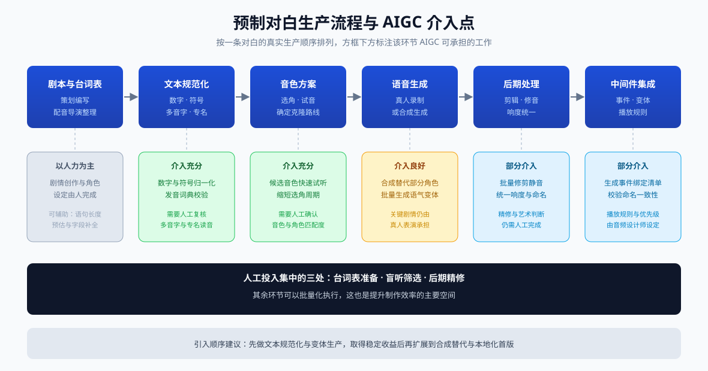
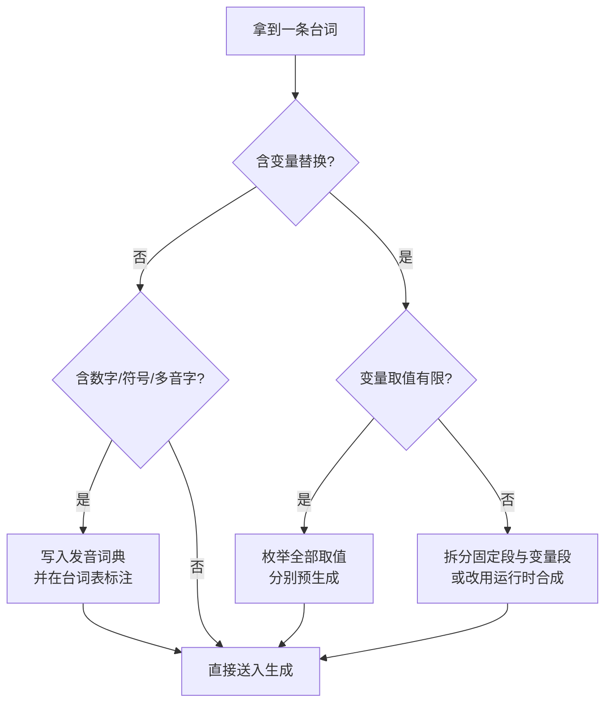
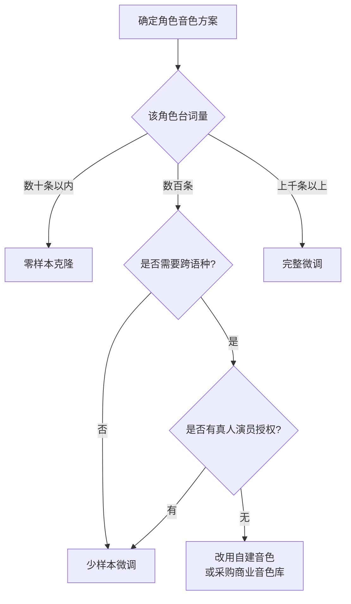
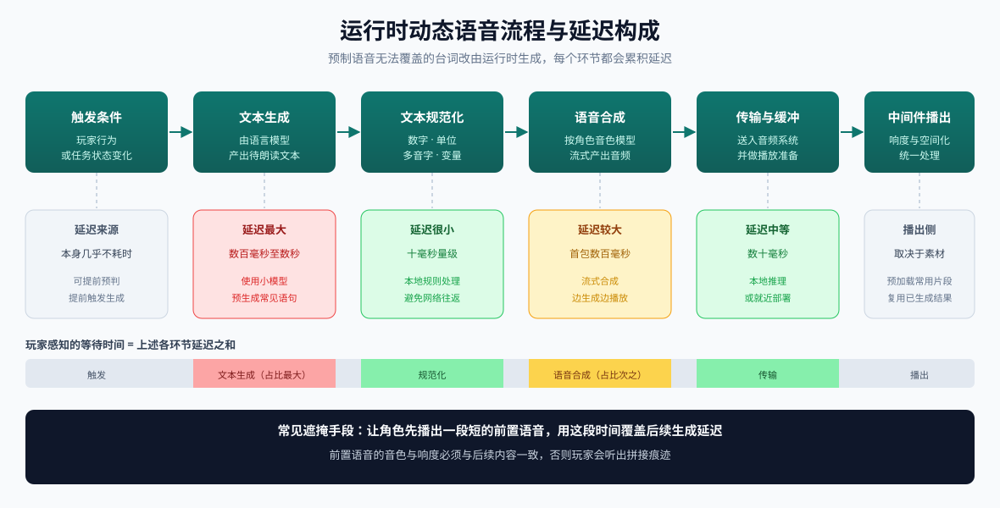

# 当下 AIGC 在游戏语音（Voice）设计中的应用

> **课程**：SHU261 基础实践
> **学号**：24122099
> **姓名**：唐清文
> **文档类型**：调研报告
> **所属题目**：当下 AIGC 在游戏音频设计中的应用（本次收敛到 Voice 方向）

---

## 摘要

游戏音频由 Voice（对白与人声）、Music（音乐）、SFX（音效）三条生产线构成。本报告把范围收敛到 **Voice 方向**，只讨论游戏内人声对白的生产与播出。

收敛的理由有三点。第一，Voice 是三条线中工程量最大的一条：一款中等规模的游戏，主要角色的台词量常在数千条，加上多语种、多语气变体，录制与后期成本远高于音乐和音效。第二，Voice 的成品直接承载剧情与角色塑造，任何瑕疵都会被玩家立刻察觉。第三，AIGC 在 Voice 方向的可介入环节最多，从台词表预处理一直到运行时动态对白，都有成熟的模型与方法。

报告按照一条对白的真实生产顺序组织：**文本侧**（台词表与文本规范化）、**音色侧**（语音克隆与音色资产）、**表演侧**（情感与韵律控制）、**语言侧**（多语言本地化）、**运行时**（动态对白生成），最后给出工程规范、质量评估方法、合规风险与一个完整的实例流程。

**说明（调研方法）**：本报告基于模型论文与开源仓库、中间件官方文档、行业报道及现行法规整理，属于文献与资料调研，未包含主观听感实验。文中标注为"工程目标"或"常见做法"的数值，均为行业惯用的经验区间，实际项目应以本项目的音频规范与本地盲听结果为准。

---

## 1. 范围界定

### 1.1 本文讨论什么

| 讨论范围 | 具体内容 |
| --- | --- |
| 讨论 | 游戏内角色对白、旁白、系统播报的人声制作与播出 |
| 讨论 | 语音合成、语音克隆、情感控制、多语言配音、运行时动态对白 |
| 讨论 | 与 Wwise / FMOD 的对接方式、素材规范、质量评估、合规要求 |
| 不讨论 | 音乐生成、音效与拟音生成 |
| 不讨论 | 语音识别（ASR）、通用降噪修复、歌曲演唱合成 |

### 1.2 Voice 方向的工作量结构

一条对白从剧本到玩家耳中，要经过多个环节。这些环节在传统流程中的分工如下：

| 环节 | 传统做法 | 主要成本 |
| --- | --- | --- |
| 剧本与台词表 | 策划编写、配音导演整理 | 人力 |
| 选角与试音 | 面试配音演员 | 人力与时间 |
| 录音棚录制 | 演员 + 录音师 + 导演 + 棚时 | 按小时计费，最高 |
| 后期处理 | 剪辑、修音、降噪、响度统一 | 人力 |
| 多语言本地化 | 每个语种重复上述全部环节 | 成倍增长 |
| 中间件集成 | 事件绑定、变体、播放规则 | 人力 |

成本最高、耗时最长的两处是**录音棚录制**与**多语言本地化**。这两处也是 AIGC 介入收益最大的位置。

---

## 2. 预制对白的生产流程与 AIGC 介入点

游戏内绝大多数对白是**预制语音**：在开发期生成好音频文件，运行时由中间件直接播放。

*图 1：预制对白生产流程与 AIGC 介入点*

各环节的 AIGC 介入方式：

| 环节 | AIGC 能做什么 | 成熟度 |
| --- | --- | --- |
| 台词表预处理 | 文本规范化、发音标注、时长预估、批量拆分与清洗 | 高 |
| 选角与试音 | 用候选音色快速生成试听样本，缩短选角周期 | 高 |
| 录制 | 用合成语音替代部分角色，或作为真人录制的补充 | 中高 |
| 后期处理 | 降噪、修复、响度统一、批量剪辑与重命名 | 中 |
| 多语言本地化 | 跨语言克隆生成各语种配音，真人仅做校订 | 中高 |
| 变体生产 | 同一句台词批量生成多种语气与距离版本 | 高 |
| 中间件集成 | 自动生成事件绑定清单与命名映射 | 中 |

其中**台词表预处理**与**变体生产**的收益稳定、争议最小，适合作为项目首次引入 AIGC 的切入点。

---

## 3. 文本侧：台词表与文本规范化

### 3.1 台词表需要哪些字段

语音合成模型的输入质量取决于台词表的质量。一张可直接送入生成流程的台词表应当包含：

| 字段 | 说明 | 示例 |
| --- | --- | --- |
| `EventID` | 中间件事件标识 | `VO_Guard_Alert` |
| `Text` | 待朗读文本 | 站住！这里禁止通行。 |
| `Character` | 角色标识，决定音色 | `Guard_A` |
| `Emotion` | 情绪标签 | `warning` |
| `Rate` | 语速倍率 | `1.0` |
| `MaxDuration` | 时长上限，超限需重生成 | `2.5s` |
| `Language` | 语种 | `zh-CN` |
| `Variant` | 需要的变体数量 | `3` |
| `Notes` | 特殊读音与表演提示 | "禁止"读 jìn zhǐ |

缺少 `MaxDuration` 与 `Notes` 两个字段是常见问题。前者导致生成结果超出对白窗口，后者导致专有名词与多音字被读错。

### 3.2 文本规范化的具体问题

TTS 模型的前端会做一层文本规范化（Text Normalization），把书面符号转成可朗读形式。中文游戏文本中容易出错的类型：

| 类型 | 输入 | 可能读错 | 处理方式 |
| --- | --- | --- | --- |
| 数字 | `3.5` | 读成"三点五"或"三五" | 在文本中显式写成汉字 |
| 年份 | `2024` | "二零二四"或"两千零二十四" | 按语境显式写出 |
| 单位与符号 | `50%`、`30℃` | 读成原始符号 | 替换为"百分之五十""三十摄氏度" |
| 多音字 | `行`、`重`、`长`、`乐`、`血` | 读音与语境不符 | 发音词典固定读音 |
| 专有名词 | 地名、技能名、种族名 | 按通用读音读，与设定不符 | 发音词典固定读音 |
| 缩略词 | `HP`、`NPC`、`AI` | 按字母读或按拼音读 | 在台词表中标注读法 |
| 变量替换 | `欢迎你，{PlayerName}` | 运行时内容未知 | 生成后再校验，或限制可替换范围 |

### 3.3 运行时变量带来的特殊问题

带变量替换的台词无法在开发期完全预生成。常见处理方式有三条：

1. **拆分拼接**：把固定部分预生成，变量部分单独生成，运行时拼接。缺点是接缝处的韵律不连续。
2. **限定取值**：把变量限制在有限的候选集合内（例如若干种称呼），全部预先录制或预生成。
3. **运行时合成**：变量部分交给运行时语音合成，见第 7 节。

多数项目采用第 2 条，因为它同时保证了韵律质量与运行效率。

---

## 4. 音色侧：语音克隆与音色资产

### 4.1 三条技术路线

语音克隆按所需的参考音频量分为三条路线，适用场景与成本差别明显：

| 路线 | 参考音频 | 音色相似度 | 跨语言能力 | 准备成本 | 适用场景 |
| --- | --- | --- | --- | --- | --- |
| 零样本克隆 | 3 秒至 30 秒 | 中等偏高 | 取决于模型 | 最低 | 原型期临时配音、语气变体、一次性角色 |
| 少样本微调 | 5 分钟至 30 分钟 | 高 | 较好 | 中等 | 常规 NPC、配角对白 |
| 完整微调 | 数小时以上 | 最高 | 好 | 最高 | 主角、需要跨越多部作品保持一致的角色 |

选择依据：

### 4.2 音色一致性

音色一致性的要求比"单句听起来像"严格得多。需要检查四个维度：

| 维度 | 检查内容 | 常见问题 |
| --- | --- | --- |
| 跨语句 | 同一角色的连续台词听起来是否同一人 | 逐句生成导致音色轻微漂移 |
| 跨情绪 | 平静与愤怒状态下是否仍是同一人 | 情绪切换时音色被明显改变 |
| 跨语种 | 同一角色在中文与英文配音中是否是同一人 | 跨语言克隆的音色偏移 |
| 跨批次 | 不同时间生成的素材能否混用 | 模型版本更新导致音色变化 |

跨批次一致性是容易被忽略的一项。生成过程中如果模型版本或参数发生变化，早期生成的素材可能与后期素材不匹配，导致整批返工。解决办法是把模型版本、推理参数与随机种子一并记录在生成记录里。

### 4.3 音色作为资产

语音克隆把"某位演员的声音"变成一份可以反复使用的模型资产。工程上需要建立：

| 管理项 | 内容 |
| --- | --- |
| 授权记录 | 声音权利人、授权项目范围、授权期限、是否允许二次衍生、是否允许再训练 |
| 模型版本 | 权重文件、参考音频、训练配置、推理参数、随机种子 |
| 生成记录 | 哪条台词由哪个模型版本生成，便于追溯与重制 |
| 使用范围 | 该音色可用于哪些角色、哪些语种、是否可用于宣传物料 |

---

## 5. 表演侧：情感与韵律控制

### 5.1 四种控制手段

| 手段 | 做法 | 控制精度 | 适用场景 |
| --- | --- | --- | --- |
| 文本内情绪提示 | 在提示文本中写入情绪词 | 较低 | 快速生成粗稿 |
| 情绪标签 | 使用模型支持的显式情绪参数 | 中等 | 需要批量按情绪分类生成 |
| 韵律标记 | 使用 SSML 控制语速、音高、音量、停顿 | 较高 | 需要精确控制节奏与停顿 |
| 参考音频引导 | 用一段带目标情绪的真人音频作为引导 | 最高 | 关键台词、需要明确表演方向 |

实际项目中通常组合使用：先用情绪标签批量生成粗稿，再对需要打磨的台词用参考音频引导重新生成。

### 5.2 生成变体的做法

同一句台词需要多个变体，做法与音效的变体生产类似：

1. 固定文本、音色与情绪标签；
2. 变化随机种子，批量生成 10 至 20 条；
3. 逐条试听，淘汰有明显缺陷的；
4. 保留 3 至 5 条进入后期；
5. 在中间件中用随机容器承载，并在播放时对音高和音量做小幅随机化。

### 5.3 常见失败模式

以下问题在生成结果中出现频率较高，应当列入试听时的检查清单：

| 失败模式 | 表现 | 处理方式 |
| --- | --- | --- |
| 长句气息断裂 | 长句中间换气位置不合理 | 拆分句子分段生成，或在标点处插入停顿 |
| 韵律漂移 | 同一段落逐句生成，情绪不连续 | 整段一次生成，或使用同一参考音频引导 |
| 表演过火 | 情绪夸张，脱离角色设定 | 降低情绪标签强度，改用参考音频引导 |
| 念稿感 | 音色相似但缺乏表演 | 更换参考音频，或在文本中加入表演提示 |
| 尾音被截断 | 句尾收音被裁掉 | 生成时预留时长余量，后期修剪时保留尾部 |
| 起音被削 | 句首辅音瞬态被削掉 | 后期修剪时保留少量前置余量 |
| 专有名词读错 | 名字、地名、技能名读音错误 | 维护发音词典，必要时改用同音字写法 |
| 呼吸音缺失 | 长段落听感不自然 | 需要时单独生成呼吸音并混入 |

---

## 6. 语言侧：多语言本地化

### 6.1 两种做法

| 做法 | 流程 | 质量 | 成本 |
| --- | --- | --- | --- |
| 跨语言克隆 | 用原语种音色模型直接生成目标语种 | 中等，音色保持一致 | 低 |
| 逐语种重新录制 | 每个语种另请配音演员 | 最高，但音色无法完全一致 | 最高 |
| 生成加校订 | 跨语言克隆出首版，由母语配音导演校订 | 较高 | 中等 |

商业项目中常见的是第三种：生成版本覆盖全部台词，校订工作集中在主要角色的关键台词上。

### 6.2 时长差异带来的问题

同一句台词在不同语言中书写的长度差异较大。英文、俄文、德文的音节数通常多于中文，直接生成会导致目标语种音频比原语种长，进而产生两个后果：

- 口型对不上，尤其是做过面部动画的角色；
- 字幕停留时间与语音不匹配。

处理方法：

1. 生成目标语种音频后测量实际时长；
2. 与该语种的时长上限比较；
3. 超限时先调整语速，其次改写译文，最后才考虑缩短表演；
4. 对做过面部动画的角色，用时长方差反推允许的语速范围，作为译文的约束条件交给本地化团队。

把时长约束提前写进译文要求，能避免大量返工。等到音频生成完成才发现超时，往往需要重译重录。

---

## 7. 运行时：动态对白生成

### 7.1 适用条件

运行时合成适合下列情况：

| 情况 | 说明 |
| --- | --- |
| 文本在运行前无法确定 | 玩家昵称、实时数值、组合生成的语句 |
| 台词量过大 | 全量预生成占用存储与生成成本都不划算 |
| 需要与玩家行为实时呼应 | 会话式角色、动态任务播报 |

不适合的情况：关键剧情台词、需要精确表演控制的台词、对延迟敏感的场景。

### 7.2 运行时流程与延迟构成

*图 2：运行时动态语音流程与延迟构成*

各环节都会贡献延迟，需要按整条流程分配预算：

| 环节 | 延迟量级 | 优化手段 |
| --- | --- | --- |
| 文本生成 | 数百毫秒至数秒 | 使用小模型、预生成常见语句、提前触发生成 |
| 文本规范化 | 十毫秒量级 | 本地规则处理，避免网络往返 |
| 语音合成首包 | 数百毫秒 | 流式合成，边生成边播放 |
| 传输与缓冲 | 数十毫秒 | 本地推理或就近部署 |
| 中间件加载 | 视素材长度而定 | 预加载常用片段 |

工程目标通常是让玩家感知不到明显停顿。常见的做法是让角色先播出一段短的前置语音（例如称呼或语气词），用这段时间覆盖后续生成延迟。

### 7.3 与预制语音的混合使用

多数项目采用混合方式：把固定台词预生成，把变量部分交给运行时合成，并在中间件中统一管理两者的播放优先级。需要处理的问题包括：

- 同一角色同时存在预制与实时两条语音来源，需要统一的播放规则；
- 实时语音的音色必须与预制语音保持一致，否则玩家会听出差别；
- 实时语音的响度需要与预制素材统一，避免忽大忽小。

---

## 8. 工程规范与中间件集成

### 8.1 素材规范

| 项目 | 要求 |
| --- | --- |
| 采样率与位深 | 48 kHz、24 位（与项目音频规范一致） |
| 声道 | 对白通常为单声道，空间化交给中间件处理 |
| 响度 | 统一到项目规定目标，具体数值以项目规范为准 |
| 首尾处理 | 修剪静音，保留少量前置余量避免起音被削 |
| 命名 | `VO_角色_事件_序号.wav`，例如 `VO_Guard_Alert_01.wav` |
| 附带文件 | 生成记录（模型版本、参数、随机种子）、授权记录 |

### 8.2 Wwise 中的对接方式

| 功能 | 对应机制 | 用途 |
| --- | --- | --- |
| 按角色与情境选台词 | Dialogue Event 搭配 Argument | 角色、情绪、情境组合选择 |
| 多变体轮播 | Random Container | 避免连续触发时听出重复 |
| 按状态切换 | Switch Container | 按角色状态或装备切换 |
| 连续参数控制 | RTPC | 按距离、伤势调节音量与音高 |
| 同时播放限制 | Voice Limit | 避免多条语音互相掩盖 |
| 优先级与打断 | Priority 与打断规则 | 保证重要台词不被无关播报盖住 |
| 长对白的加载方式 | 流式播放 | 减少内存占用 |

其中 Voice Limit 与优先级是语音系统中最容易出问题的两项。缺少限制时，多角色同时说话会造成语音互相掩盖，玩家听不清任何一句。

### 8.3 版本管理

音频素材体积较大，纳入版本管理时需要注意：

- 源文件与生成记录一并保存，便于重制；
- 大体积素材考虑使用 Git LFS；
- 提交信息按约定式规范书写，例如 `assets:` 前缀标识素材更新。

---

## 9. 质量评估

### 9.1 盲听测试设计

生成结果的质量不能只看单条样本，需要设计可重复的评估流程：

| 项目 | 做法 |
| --- | --- |
| 评估维度 | 自然度、音色相似度、情感准确度、可懂度、与既有真人素材的一致性 |
| 评分方式 | 五级评分或与真人素材成对比较 |
| 遮蔽方式 | 双盲，评估者不知道哪条是生成结果 |
| 评估人数 | 至少 5 名非项目成员 |
| 样本量 | 每组参数组合至少 20 条 |
| 记录内容 | 每组参数的通过率与主要失败模式 |

### 9.2 三级门槛

建议在项目内建立统一门槛：

1. **可用**：无明显伪影，读音正确，时长符合上限；
2. **合格**：与既有真人素材的响度和音色风格一致，可直接入库；
3. **优秀**：可直接用于关键剧情，无需后期；

多数项目的经验是：一次批量生成的结果中，能达到"合格"的比例有限。因此批量生成加高淘汰率应当写进项目计划，作为正常流程的一部分。

---

## 10. 风险与合规

### 10.1 声音人格权

中国《民法典》对自然人声音的保护参照肖像权的规定处理。北京互联网法院审理的全国首例 AI 生成声音人格权侵权案确立了一个重要立场：**自然人声音权益的保护范围及于经人工智能技术处理后的声音**——即用 AI 合成的声音同样落在原声源人的权利范围之内。

实践含义：使用语音克隆前必须取得声音权利人的明确授权；素材即使来自公开视频，也不能默认可以商用。

### 10.2 内容标识

《人工智能生成合成内容标识办法》已于 2025 年 9 月 1 日起施行，配套强制性国家标准 GB 45438—2025《网络安全技术 人工智能生成合成内容标识方法》要求对 AI 生成合成内容进行**显式标识**与**隐式标识**。

对游戏项目的含义：如果游戏中包含 AI 生成的语音，需要考虑在音频文件的元数据中写入隐式标识，并在玩家可分享的内容与宣传物料中提供显式提示。这与第 4.3 节的生成记录管理属于同一套合规要求的两端。

### 10.3 平台披露

Valve 自 2024 年起要求开发者在 Steam 上披露游戏中的 AI 生成内容，并在其后对条款做了澄清，区分预生成内容与运行时实时生成两种情况。上架前需要核对当时的政策原文。

### 10.4 从业者权益

SAG-AFTRA 的互动媒体协议把 AI 条款作为谈判核心，诉求集中在明示同意、合理补偿与使用披露三点。对学生的意义在于建立正确的职业观：使用合成语音时仍然需要尊重配音演员的权益。

### 10.5 技术局限

| 局限 | 说明 |
| --- | --- |
| 长段落的连贯性 | 超过一定长度的段落容易出现韵律漂移 |
| 中文多音字 | 需要发音词典兜底，无法完全依赖模型 |
| 情感跨度 | 大跨度的情绪转折仍是薄弱环节 |
| 表演层次 | 细微的语气变化与停顿设计难以精确控制 |
| 结果可复现 | 相同文本在不同时间或版本下可能得到不同结果，必须记录生成参数 |
| 风格趋同 | 同一模型大量使用会让不同角色的声音听感接近 |

---

## 11. 实例流程：一条台词的完整处理

以一条普通守卫的警告台词为例，走完整条流程。

**原始台词**：`站住！这里禁止通行。`

| 步骤 | 操作 | 结果 |
| --- | --- | --- |
| 1 | 录入台词表 | `EventID=VO_Guard_Alert`、`Emotion=warning`、`MaxDuration=2.5s`、`Variant=3`、备注"禁止读 jìn zhǐ" |
| 2 | 文本规范化 | 确认标点停顿，感叹号后留短停，句号后留长停 |
| 3 | 确定音色方案 | 该角色台词量约 200 条，采用少样本微调 |
| 4 | 设置生成参数 | 语速 1.0、音高 0、情绪标签 warning、参考音频取该角色此前的愤怒台词 |
| 5 | 批量生成 | 变化随机种子生成 6 条候选 |
| 6 | 盲听筛选 | 淘汰 3 条（1 条表演过火、1 条尾音被截断、1 条读音错误） |
| 7 | 后期处理 | 修剪静音、保留前置余量、统一响度、导出 48 kHz / 24 位 WAV |
| 8 | 命名保存 | `VO_Guard_Alert_01.wav` 至 `VO_Guard_Alert_03.wav` |
| 9 | 导入中间件 | 建立 Dialogue Event `Guard_Alert`，用 Random Container 容纳 3 个变体 |
| 10 | 绑定规则 | 距离衰减用 RTPC 控制，Voice Limit 设为 2，优先级中等 |
| 11 | 游戏内验证 | 连续触发 10 次，确认没有明显重复感，且不被其他播报掩盖 |

整条流程中，人工投入集中在第 1 步（台词表准备）、第 6 步（盲听筛选）与第 7 步（后期处理）。其余步骤可以批量化执行。

---

## 12. 结论与展望

1. **AIGC 在 Voice 方向最成熟的应用是变体生产与初稿，其次是多语言本地化的首版生成。** 关键剧情台词与需要精细表演的部分仍由真人承担。
2. **文本侧的质量决定了整条流程的天花板。** 发音词典与台词表字段的完整程度，比模型选型更能决定最终听感。
3. **音色必须作为带授权记录的资产来管理。** 缺少生成记录与授权记录的音色，在项目后期会成为无法追溯的负担。
4. **合规要求已经具体到可执行的程度。** 声音人格权、内容标识与平台披露三项，都需要在制作流程中安排对应的操作。
5. **趋势判断**：语音合成的竞争重点会从单句质量转向整段表演的可控性与运行时播出的稳定性，也就是与中间件结合得越紧密的方案越有实用价值。

---

## 13. 术语对照

| 中文 | 英文 | 说明 |
| --- | --- | --- |
| 语音合成 | Text-to-Speech, TTS | 由文本生成语音 |
| 语音克隆 | Voice Cloning | 由参考音频复制音色 |
| 零样本克隆 | Zero-shot Cloning | 仅用数秒参考音频完成克隆 |
| 少样本微调 | Few-shot Fine-tuning | 用数分钟音频微调模型 |
| 语音转换 | Voice Conversion | 保留内容，替换音色 |
| 文本规范化 | Text Normalization | 把书面符号转为可朗读形式 |
| 发音词典 | Pronunciation Lexicon | 固定专有名词与多音字的读音 |
| 韵律 | Prosody | 语速、音高、停顿与重音的整体表现 |
| 音频返回 | Audio-to-Audio, A2A | 由音频生成音频，含风格迁移 |
| 盲听测试 | Blind Listening Test | 评估者不知道样本来源的主观评测 |
| 中间件 | Middleware | Wwise、FMOD 等音频集成工具 |
| 变体 | Variant | 同一事件的多个可轮播版本 |

---

## 14. 参考资料

**技术与模型**

- Audiokinetic Wwise 官方文档，Dialogue Event 与 Interactive Music — https://www.audiokinetic.com/public-library/
- Elias 4，自适应游戏音频中间件 — https://elias.audio/products/elias-4/
- *AI Audio Implementation steps in Unity* — https://gamixlabs.com/blog/ai-audio-implementation-guide-for-unity-step-by-step/
- ElevenLabs × Rosebud AI：默认自带音频的 AI 生成游戏 — https://elevenlabs.io/zh/blog/rosebud-ai
- *AI Voice Acting for Indie Games*, ElevenLabs / Play.ht / Resemble 对比 — https://www.strayspark.studio/blog/ai-voice-acting-indie-games-elevenlabs-2026

**行业与伦理**

- SAG-AFTRA 新版电子游戏协议解读 — https://www.dglaw.com/sag-aftras-new-video-game-agreement/
- *Actors' Union Not Impressed With AI Darth Vader Voice in Fortnite* — https://tech.yahoo.com/gaming/articles/actors-union-moves-against-epic-094641528.html
- Valve 对 Steam AI 披露规则的更新 — https://www.gamedeveloper.com/business/valve-tweaks-and-clarifies-ai-disclosure-rules-for-steam

**法规与司法**

- 国家互联网信息办公室，《人工智能生成合成内容标识办法》答记者问 — https://www.cac.gov.cn/2025-03/14/c_1743654685896173.htm
- GB 45438—2025《网络安全技术 人工智能生成合成内容标识方法》国家标准信息 — https://openstd.samr.gov.cn/bzgk/std/newGbInfo?hcno=F32EA2A561F1886CD8D606513512D547
- 全国首例 AI 生成声音人格权侵权案（北京互联网法院）— http://e.mzyfz.com/paper/2482/paper_66465_13540.html

---

*本文档为 SHU261 基础实践课程平时作业。*
